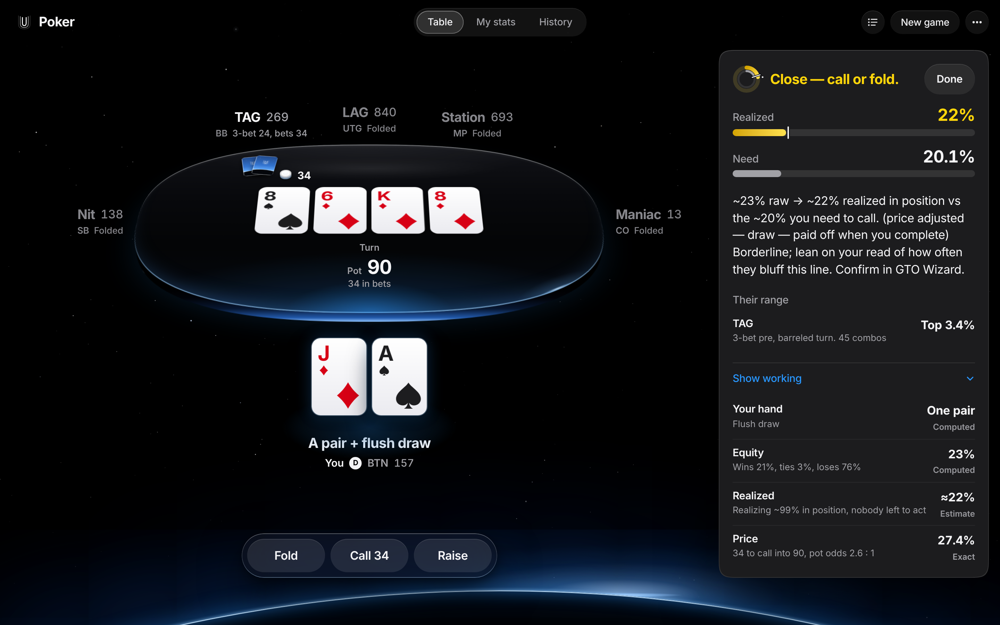
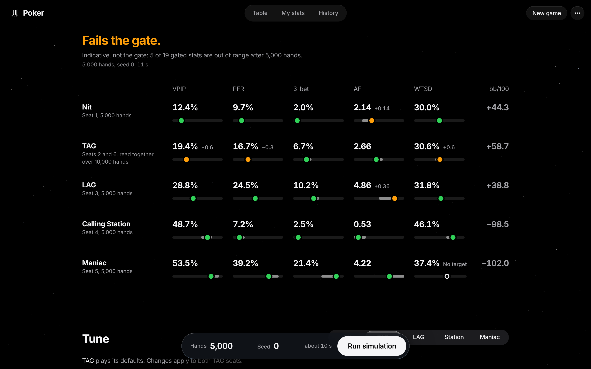
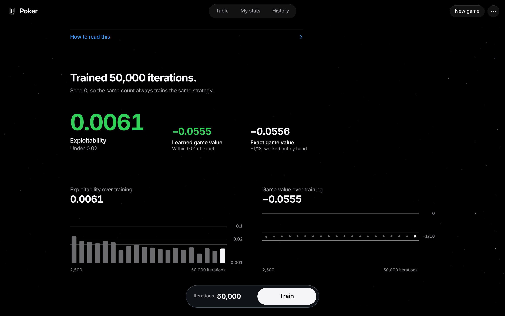
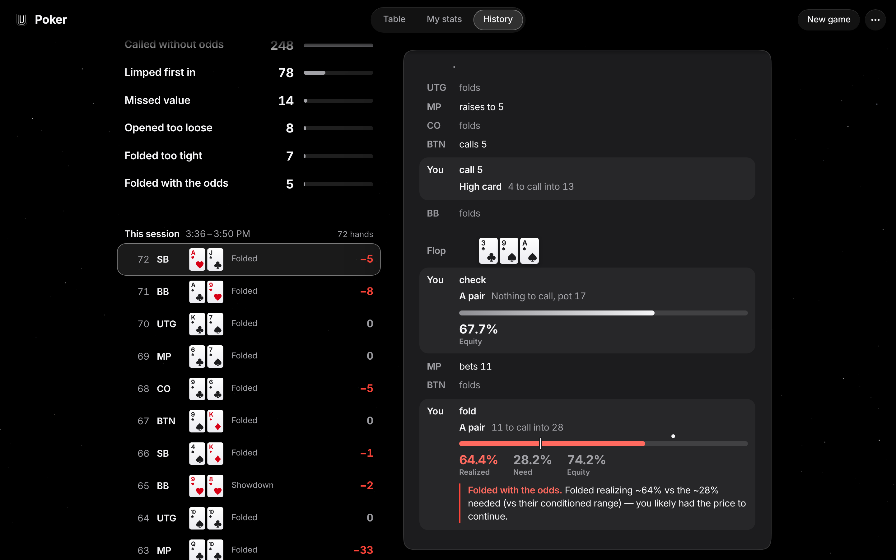
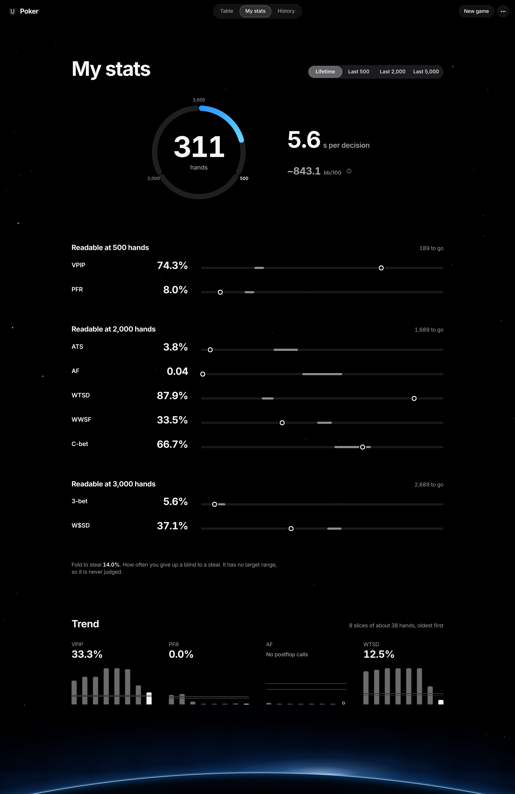

# Poker

A single-player 6-max No-Limit Hold'em trainer. You play a cash table against five bot
archetypes, and a coaching layer shows the arithmetic behind every decision: your equity
against the opponent's modelled range, the price you are being offered, and whether the
call is profitable.

I built it because most poker study tools either give you a solver output with no
derivation, or give you a "feel" with no numbers at all. I wanted the middle: something
that computes a concrete answer and shows its work, so I could check the reasoning rather
than trust it.

It is a personal training tool - single-user, play-money, local-first. It is not a GTO
solver and does not claim to be.

## What it looks like



The table with the coach's maths open. Holding A♠ J♦ on the button, facing a 34-chip turn
bet from the TAG, who 3-bet preflop from the big blind: 34 to call into 90 on 8♠ 6♦ K♦ 8♦.
The coach reads a pair (the board's eights) plus a flush draw and calls it close: 23% raw
equity, about 22% realised in position, against a 27.4% price that the flush draw's implied
odds lower to a 20.1% need. The range it priced against is conditioned on the line the TAG
took ("3-bet pre, barreled turn"), which leaves the top 3.4%, 45 combos. Under Show working,
each row says whether it is Exact, Computed or an Estimate.



The bot lab after a 5,000-hand run of the default lineup (seed 0, 11 seconds), all five
archetypes measured against their STRATEGY.md §4 bands. At that sample it fails the gate:
five of the 19 gated stats sit just outside their bands - the Nit's AF at 2.14 (+0.14), the
TAG's VPIP, PFR and WTSD (−0.6, −0.3, +0.6, its two seats read together over 10,000 hands)
and the LAG's AF at 4.86 (+0.36) - and the lab labels the result indicative, not the gate.
The Maniac's WTSD reads "No target". The statistics are outputs, so the loop is: move a
knob, re-run, see where the measured numbers land. The in-browser run is capped at 25,000
hands - the ≥100,000-hand gate described below runs offline.



CFR on Kuhn poker after 50,000 iterations (seed 0): exploitability 0.0061, under the 0.02
pass line, and a learned game value of −0.0555 against the exact −1/18 ≈ −0.0556. Below
them are the 20 training checkpoints on fixed scales: exploitability on a log scale, where
only the first checkpoint (2,500 iterations) sits above the 0.02 line, and the game value,
on the −1/18 line from the start. The learned strategy for all twelve information sets is
further down the page.



Hand review. Every stored hand replays street by street, and each decision is re-scored
against the equity it actually needed. The flagged line here is a fold: A♥ J♣ in the small
blind, a pair of aces folded to a bet of 11 into 28 on 3♣ 9♠ A♠ while realising 64.4%
against the 28.2% a call needed. On the left, the leak report counts the ones that recur
over all 311 stored hands: 248 calls without the odds, 78 limps first in, 14 missed value
bets, and so on.



The statistics view - your own play held to target bands, over the same 311 hands. A stat
stays hollow and unjudged until the sample is large enough to read it: VPIP and PFR at 500
hands (189 to go here), ATS, AF, WTSD, WWSF and C-bet at 2,000, 3-bet and W$SD at 3,000,
so nothing on this page is judged yet. The facts are 5.6 seconds per decision and −843.1
bb/100. These hands were played while testing the app and taking these screenshots, most
of them by calling far too much, which is why VPIP reads 74.3% and WTSD 87.9%.

## The strategy model

A bot is a **parameter set**, not a script. `poker.bots.strategy` defines one
parameterised strategy: positional opening ranges, a postflop heuristic over
`poker.math`, bet sizing, calldown thresholds, and a bluff frequency. An archetype is
that strategy with different numbers - `poker.bots.archetypes` holds five of them (Nit,
TAG, LAG, Calling Station, Maniac).

The point is that the *observable* statistics are outputs, never inputs. You cannot set a
bot's VPIP. You give it a strategy, simulate, measure what comes out, and adjust the
parameters until the measured statistics land in the archetype's target band. The bands
themselves are in [STRATEGY.md](STRATEGY.md) §4.

`backend/validation/phase3_gate.txt` records the run that validates this: **100,000
hands, seed 0**, all five archetypes measured against their bands.

```
archetype                VPIP         PFR    THREEBET          AF        WTSD
Nit                    11.7✓        9.1✓        2.2✓        1.8✓       31.2✓
TAG                    20.3✓       17.4✓        6.9✓        3.2✓       29.3✓
LAG                    28.4✓       23.7✓       10.2✓        4.0✓       31.6✓
Calling Station        48.7✓        7.1✓        2.2✓        0.5✓       44.3✓
Maniac                 53.4✓       39.2✓       21.6✓        4.2✓       36.2
```

Reproduce it with `.venv/bin/python scripts/simulate.py --hands 100000 --seed 0`
(about 110 seconds).

**What the gate actually covers, precisely:** VPIP, PFR, AF and WTSD are gated for every
archetype, which is 20 cells. Nineteen carry a real two-sided band. Two do not behave
like the rest and should be read with that in mind: the Maniac's WTSD has **no band**,
because STRATEGY.md §4 records it as "varies" and I would rather leave it unbanded than
invent a number to gate against; and the Maniac's AF band is one-sided (`>4`), so it is
bounded below only. Everything else is a genuine two-sided interval.

## The equity engine

`poker.math.equity` runs a Monte Carlo simulation using **treys** for hand evaluation.
It deals the remaining board, samples opponent holdings from their assigned range, and
counts how often the hero's hand is best at showdown. Ties split, so the returned win /
tie / lose fractions sum to one - a property [`test_math.py`](backend/tests/test_math.py)
asserts directly.

Trial counts are set where they are used: the live coach runs **4,000** trials per
decision (`build_coaching`), and hand review runs 1,200-1,800, because review re-evaluates
every street of every stored hand and the extra precision is not worth the latency.

Two things sit on top of the raw equity number:

- **Pot odds and required equity** (`poker.math.odds`) are computed exactly, not
  simulated. Required equity is `call / (pot + call)`.
- **Realised equity.** Raw equity overstates a hand that will not get to showdown -
  out of position, facing more streets, with no way to improve. The coach discounts raw
  equity by a realisation factor before comparing it to the price, which is why it does
  not recommend calling with every hand that is nominally ahead.

## The opponent model

Villain ranges are **conditioned on the actions actually taken**. A player who opens,
c-bets the flop and barrels the turn holds a different range from one who limped and
checked twice, and `poker.coach.villain_model` narrows the range street by street to
reflect that.

The part I care most about is the bluff frequency. A river bluff-catch turns entirely on
what fraction of the villain's betting range is air, so that fraction cannot be guessed.
It is **measured from the bots themselves**: `BET_COMPOSITION` holds the value / draw /
air split of each archetype's betting range per street, measured over a 60,000-hand
simulation and recorded alongside the gate in `backend/validation/phase3_gate.txt`.
The coach labels its output as "measured from the bots" only when a measured composition
was actually available for that spot, and falls back to a neutral prior otherwise.

## The CFR solver

`poker.learn.kuhn_cfr` implements vanilla Counterfactual Regret Minimization on Kuhn
poker - the smallest poker game with a non-trivial equilibrium.

Kuhn is the right test case because its equilibrium is **known in closed form**, so the
solver can be checked against an exact answer rather than against itself. The game value
to the first player is exactly **−1/18 ≈ −0.0556**.

Three independent checks, all in [`test_lab_and_cfr.py`](backend/tests/test_lab_and_cfr.py):

- `test_cfr_game_value_converges` - the average strategy's value is within 0.01 of −1/18.
- `test_cfr_exploitability_small` - exploitability, computed by **exact best response**
  rather than estimated, falls below 0.03.
- `test_exploitability_zero_at_known_equilibrium` - feeding in an analytically-derived
  equilibrium strategy yields ~zero exploitability. This one matters: it tests the
  *measuring instrument*, so a bug in the exploitability calculation cannot flatter the
  solver.

## What the tests assert

**110 tests**, run with `.venv/bin/python -m pytest`. They are not smoke tests; the
majority check a specific numeric or structural property:

| Area | Tests | Examples of what is asserted |
|---|---|---|
| `test_math.py` | 21 | AA vs KK preflop equity, flush-draw equity, made flush dominance, win/tie/lose fractions summing to 1, required-equity worked examples, range parsing and blocker removal, no combo containing a duplicate card |
| `test_engine.py` | 13 | hand-ranking order, split pots when the board plays, three-way side-pot distribution, legal actions by position and facing bets, short-stack all-in, illegal actions rejected, and **chip conservation across randomised complete hands** |
| `test_lab_and_cfr.py` | 12 | the three CFR checks above, plus the lab's report structure, hand caps, and that loosening a calldown knob actually raises the measured WTSD |
| `test_api.py` | 10 | endpoint contracts end to end |
| `test_coach.py` | 12 | that a hand well ahead raises rather than just calling - judged on equity, not on the made tier alone - that the coach never suggests a bet or raise the engine would reject, that a marginal out-of-position call flips to a fold once equity is realised rather than raw, and that every verdict string carries a tone |
| `test_villain_model.py` | 6 | that a flop bet narrows the range, barrelling de-bluffs it, a 3-bet is tighter than an open, and the river bluff slice is low and ordered by archetype |
| remainder | 36 | bot/sim behaviour, implied-odds spots, leak detection, replay reconstruction, calibration |

Chip conservation is the one I would point at first: it plays randomised hands to
completion and asserts that chips are neither created nor destroyed, which catches a
whole class of engine bug that per-case tests miss.

## Architecture

Python brain, React face, talking over REST. See [ARCHITECTURE.md](ARCHITECTURE.md) for
the module map, [STRATEGY.md](STRATEGY.md) for the poker content, and
[DESIGN.md](DESIGN.md) for the visual spec.

- **Backend** - Python 3.11+, [PokerKit](https://github.com/uoftcprg/pokerkit) (game state
  and hand evaluation), [treys](https://github.com/ihendley/treys) (fast Monte Carlo),
  FastAPI + uvicorn, SQLite via SQLAlchemy. Chips are integers throughout.
- **Frontend** - React 19 + Vite + TypeScript + Tailwind v4, in the Stage design. One type
  family: SF Pro on Apple devices and Inter Variable everywhere else, self-hosted (no font
  CDN), with tabular figures for every number. The table is a CSS 3D object whose camera is
  also written as a pure function, so type, your hand and the bet labels sit upright at
  projected points and are never skewed by the 3D. Cards are inline SVG, so there are no image assets and no per-card requests.
  The pure logic in `frontend/src/lib` has 371 vitest tests, run with `npm test`.

## Running it

```bash
cd backend
python3 -m venv .venv
.venv/bin/python -m pip install -e ".[dev]"
.venv/bin/python -m pytest                        # 110 tests
.venv/bin/uvicorn poker.api.app:app --reload      # http://127.0.0.1:8000/health, docs at /docs
```

```bash
cd frontend
npm install
npm test                                          # 371 tests (vitest)
npm run dev                                       # http://localhost:5173
```

The frontend expects the API at `http://localhost:8000`; point it elsewhere with
`VITE_API_URL`, which Vite bakes in when it builds or starts rather than reading at runtime.

Sessions are held in process memory, so the API must run with **exactly one worker**; it
refuses to start otherwise. The database path is set with `POKER_DB_URL` and defaults to
`sqlite:///poker.db`.

## Limitations

I would rather state these than have them found.

- **The bots do not adapt.** Each archetype plays its fixed parameter set regardless of
  how you play. Making them adapt would invalidate the statistical gate above, which is
  the project's main correctness guarantee, so it is deliberately not done.
- **Preflop ranges are percentile-based**, ranked by all-in equity. This under-rates small
  pairs and suited connectors, whose value comes from set-mining and implied odds rather
  than raw equity, so early-position ranges open slightly fewer of them than an explicit
  hand-list would.
- **The coach's conditioned range is slightly under-confident.** Against a villain's
  river bet it under-rates the hero by about **0.03 equity** overall (per-archetype
  roughly −0.03 to −0.05, on 1,205 river spots). That is the safe direction for a
  bluff-catch - it errs toward folding rather than paying off - but it is a real bias.
  The recorded run is `backend/validation/coach_calibration.txt`, reproducible with
  `.venv/bin/python scripts/coach_calibration.py --hands 6000 --seed 0`. The figures
  move by roughly ±0.001 between runs, so treat them as approximate. For comparison,
  the unconditioned static range over-rates the hero by +0.049, which is the
  over-calling bias the conditioning exists to remove.
- **No exact GTO frequencies.** The coach computes equity, pot odds and EV. Where a
  question genuinely needs an equilibrium frequency, it says so and defers to a solver
  rather than inventing a number.
- **No authentication.** Every endpoint is open, which is fine for a local single-user
  tool. Any deployment must put access control in front of it - the application provides
  none of its own.

## What I would do next

- **Give the Maniac a defensible WTSD band** so all 20 gated cells are two-sided,
  which means deriving one from measurement rather than asserting it.
- **Replace the percentile preflop ranking with explicit positional hand lists**, and
  re-run the gate - this changes the measured bet composition, so the coach's bluff
  frequencies would need re-measuring at the same time.
- **Extend CFR beyond Kuhn** to Leduc, where the equilibrium is still checkable but the
  game is large enough that abstraction starts to matter.
- **Import real hand histories** so the leak detector runs against hands played
  elsewhere, not only against this table.
